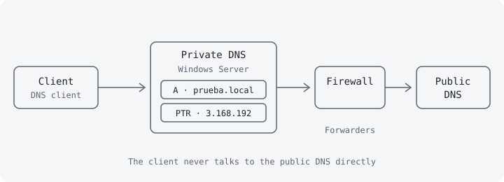

## Problem

Active Directory depends entirely on DNS: without correct name resolution, machines cannot find the domain controller or authenticate. This project documents, step by step, how to deploy and validate the DNS service in a domain environment. It starts from how names were resolved before DNS (the `lmhosts` file and NetBIOS names of up to 15 characters) and ends with a DNS service using FQDNs, zones and controlled internet access. It was built in a virtual lab on Windows Server 2022 as a reusable implementation guide.

## Architecture

The client only talks to the private DNS server, which is authoritative for the lab domain (`prueba.local`). When a query is for a domain it does not know, such as `www.microsoft.com`, it forwards it through the firewall to the public DNS using forwarders. An Active Directory DNS server must never point directly at a public DNS server.

## Stack

- **Windows Server 2022**: *DNS Server* role, installed from Server Manager or with `Install-WindowsFeature -Name DNS -IncludeManagementTools`.
- **Forward lookup zone** (`prueba.local`): name → IP, with A, NS and SOA records.
- **Reverse lookup zone** (`3.168.192.in-addr.arpa`): IP → name, with PTR records.
- **PowerShell and network tools** (`nslookup`, `nbtstat`, `ipconfig /registerdns`): verification and troubleshooting.

## Decisions and trade-offs

1. **FQDNs instead of NetBIOS names.** `lmhosts` (with `#PRE` to preload the cache and `nbtstat -R`) works on small networks, but it does not scale and short names do not reflect the real structure. With a DNS suffix, `marketing01` becomes `marketing01.prueba.local`. The trade-off is giving up the simplicity of a flat file for hierarchical, centralised resolution.
2. **An explicit reverse zone.** Without it, `nslookup` reports `UnKnown` as the default server, because the DNS cannot translate its own IP into a name. If the zone is recreated, the PTR record does not come back on its own: it has to be forced by rebooting, ticking *Update Associated Pointer (PTR) record* on the A record, or running `ipconfig /registerdns`.
3. **Dynamic updates.** In the lab all updates (secure and non-secure) were allowed so clients register themselves. It is convenient, but the wizard itself warns that it is a risk (see threat model).
4. **Forwarders instead of pointing at a public DNS.** It concentrates internet access in a single point controlled by the firewall, at the cost of making the private DNS a single point of failure for browsing.

## Threat model (summary)

| Threat | Impact | Control |
|---|---|---|
| Non-secure dynamic updates: any source could create or overwrite records | Name spoofing, traffic redirection | In production, an AD-integrated zone with "secure dynamic updates only". The insecure option was used in the lab only |
| Domain clients querying a public DNS directly | Internal name leakage, uncontrolled resolution | Machines only use the private DNS, which forwards through the firewall |
| Missing reverse zone or wrong PTR | Troubleshooting failures, and failures in services that validate reverse IPs | Checked with `nslookup` and PTR registration |
| Public zone managed with dynamic records | Unwanted records reachable from the internet | Disable dynamic updates on zones for public domains |

## Evidence and metrics

The guide is validated with a five-step checklist, all completed: install the service, configure TCP/IP (static IP, DNS pointing to itself), create the zones, configure the server FQDN and test with `nslookup`.

- `nslookup` with no arguments returns the DNS server's own FQDN as default server, resolved through the reverse zone.
- `nslookup <fqdn>` returns the server name and IP, confirming the forward zone.
- With the reverse zone deleted, the default server becomes `UnKnown`, and it resolves again once the zone is recreated and the PTR registered.
- With `lmhosts`, after `#PRE` and `nbtstat -R`, `nbtstat -c` lists the preloaded entries and `ping` resolves the name.

The network values (`192.168.x.x`, `prueba.local`) belong to the isolated lab.

## Lessons learned

- DNS is the foundation of Active Directory: build and validate it before promoting the domain controller.
- The reverse zone is optional for things to "work", but needed for proper diagnostics and for services that validate reverse IPs.
- PTR records are not regenerated when a zone is recreated; it is worth knowing the three ways to force them.
- The convenient option of open dynamic updates is the least secure. A real environment would use AD-integrated zones with secure updates.
- A second iteration should add a second DNS server to remove the single point of failure.
