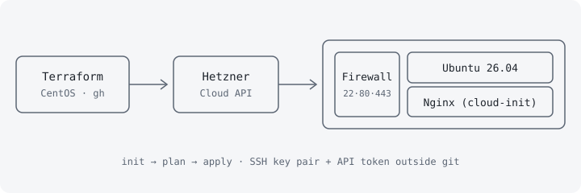

## Problem

A small hospitality business wants to host its static website in the cloud, with a basic firewall (only ports 22, 80 and 443) and without building the server by hand every time. The goal of the project is to learn how to create instances, access them over SSH, apply provider-level firewalls and configure an Nginx web server, all in a reproducible way. It is the first level of a series of cloud architectures on Hetzner, with cost as the constraint: a small instance and one public IPv4 address.

## Architecture



From a CentOS machine with Terraform, `terraform apply` is run. The Hetzner provider creates the SSH key, the firewall and the server. On first boot, `cloud-init` installs Nginx, writes `index.html` and enables the service. The firewall is attached to the server from Terraform through `firewall_ids`.

## Stack

- **Terraform** (`hetznercloud/hcloud` provider): infrastructure as code, with state and sensitive variables kept out of the repository.
- **Hetzner Cloud**: CX23 instance running Ubuntu 26.04 in Helsinki, cheap because it uses older hardware.
- **cloud-init**: installs Nginx and publishes the content on first boot, without connecting to the server.
- **Hetzner firewall**: provider-level filtering, before traffic reaches the machine.
- **GitHub and `gh`**: version control for the infrastructure code.
- **`hcloud` (CLI)**: debugging without leaving the terminal for the web console.

Project layout:

```text
nivel1-single-instance/
├── main.tf          # provider, SSH key and server
├── variables.tf     # variables (the token is sensitive)
├── firewall.tf      # provider firewall rules
├── cloud-init.yaml  # first-boot provisioning
├── outputs.tf       # IPv4 and IPv6 outputs
└── terraform.tfvars # local values, NEVER committed
```

## Decisions and trade-offs

1. **Provider firewall versus host firewall.** Filtering happens in Hetzner, not with `ufw` inside the machine: it is declarative, lives in the same code and uses no instance resources. If the server had its own firewall, it would have to be disabled to avoid duplicated rules.
2. **A dedicated SSH key for the project.** An `ed25519` pair generated only for the lab (`hetzner_lab`), loaded into `ssh-agent`, instead of reusing the personal key. Terraform uploads only the public key, and the private key never leaves the control machine.
3. **Secrets out of git.** The API token enters through a `sensitive` variable, and its value lives in `terraform.tfvars` or in the environment. `.gitignore` excludes `*.tfstate`, `.terraform/` and `terraform.tfvars`.
4. **cloud-init instead of configuring over SSH.** A repeatable deployment with no manual steps, at the cost of coupling the content to the initial boot: changing the website later means recreating the instance or using another tool (for example Ansible).

Firewall excerpt (the other rules repeat the pattern for ports 80, 443 and ICMP):

```hcl
resource "hcloud_firewall" "basic" {
  name = "nivel1-basic-fw"

  rule {
    direction  = "in"
    protocol   = "tcp"
    port       = "22"
    source_ips = ["0.0.0.0/0", "::/0"]
  }
}
```

## Threat model (summary)

| Threat | Impact | Control |
|---|---|---|
| Leak of the Hetzner API token | Full control of the account and its spend | `sensitive` variable, value in a git-ignored `terraform.tfvars`, never in code |
| Theft of the SSH private key | `root` access to the server | Key dedicated to the project, loaded in `ssh-agent`, kept outside the repository |
| Exposure of unintended services | Larger attack surface | Firewall with only 22, 80 and 443 open (plus ICMP) |
| SSH open to the whole internet (`0.0.0.0/0`) | Brute force and scans against port 22 | Key-based authentication. Restricting the source to specific IPs is left as an improvement |
| Leaked Terraform state | `tfstate` may contain sensitive data | `*.tfstate` ignored by git. In a team, encrypted remote state |

## Evidence and metrics

Checks run after `terraform apply` (no IP addresses or account identifiers shown):

- `hcloud server list` shows the instance in the `running` state.
- `hcloud server describe` confirms the CX23 type (2 shared vCPUs, 4 GB RAM, 40 GB disk, x86).
- `curl http://$(terraform output -raw server_ip)` returns the `index.html` served by Nginx.
- `ping` to the public IP answers with 0 % loss, because the firewall allows ICMP.
- `ssh -i ~/.ssh/hetzner_lab root@$(terraform output -raw server_ip)` opens a session on Ubuntu 26.04 LTS.
- `terraform destroy` removes every resource at the end, avoiding leftover costs.

The public IPv4 address costs roughly €0.50 per month.

## Lessons learned

- Running `terraform plan` before `apply` avoids surprises on the bill.
- `.terraform.lock.hcl` was excluded from git in this project, but HashiCorp recommends committing it to pin provider versions.
- The firewall is described as filtering "inbound and outbound", but only inbound rules were defined. The outbound policy should be a deliberate decision.
- Port 443 was opened, but the site is served over HTTP: a TLS certificate (for example Let's Encrypt) is missing to make use of it.
- Next steps: restrict SSH to known IPs, disable `root` login over SSH and move from a single instance to a multi-tier architecture.
