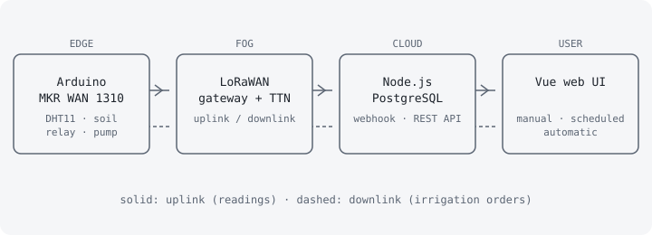

## Problema

Gestionar el riego a distancia exige saber en qué estado están el cultivo y el ambiente, y poder actuar sobre la bomba sin desplazarse, algo costoso en parcelas grandes y poco práctico en huertos pequeños. Vivantia es un prototipo funcional que resuelve ambas cosas: sensores que miden temperatura, humedad ambiental y humedad del suelo, un actuador que abre y cierra la bomba, y una aplicación web para decidir cuándo regar. El sistema debe funcionar en remoto durante periodos largos y con bajo consumo, y regar solo cuando hace falta para reducir el consumo de agua. Lo desarrollé como Trabajo Fin de Grado en Ingeniería Informática (Universidad de Córdoba) con una planificación de 300 horas.

## Arquitectura

El sistema se divide en cuatro módulos con bajo acoplamiento:

- **Edge:** un Arduino MKR WAN 1310 lee un sensor DHT11 (temperatura y humedad ambiental) y un sensor capacitivo de humedad del suelo, y acciona la bomba mediante un relé.
- **Fog:** un gateway LoRaWAN y The Things Network (TTN) recogen y preprocesan los mensajes, decodificando los bytes a JSON con un *payload formatter*.
- **Cloud:** un servidor Node.js con Express recibe las lecturas por un webhook HTTP, las guarda en PostgreSQL y expone una API REST.
- **Interfaz web:** muestra en tiempo real las lecturas y permite gestionar cultivos, dispositivos y riego.

El flujo de *uplink* lleva las lecturas desde el sensor hasta la base de datos. El de *downlink* lleva las órdenes de riego desde la web hasta la bomba, a través de la API de TTN. El dispositivo envía además *uplinks* vacíos periódicos para reducir la latencia de los downlinks en LoRaWAN Clase A.

## Stack

- **Hardware:** Arduino MKR WAN 1310, DHT11, sensor capacitivo de humedad de suelo v1.2, relé de 5 V y micro bomba RS PRO, dentro de una caja estanca.
- **Comunicaciones:** LoRa y LoRaWAN (Clase A, bajo consumo y largo alcance) con TTN como servidor de red.
- **Backend:** Node.js y Express con patrón MVC, API REST y Nodemailer para el correo de verificación.
- **Base de datos:** PostgreSQL, con las condiciones óptimas por cultivo.
- **Frontend:** Vue.js con Nuxt, Pinia para el estado y Tailwind CSS.
- **Seguridad:** JWT, bcrypt, middleware por roles y OTAA.

## Decisiones y trade-offs

1. **LoRaWAN en lugar de Wi-Fi o 4G/5G.** Se compararon las tres tecnologías. LoRaWAN ofrece largo alcance y muy bajo consumo, ideales para un dispositivo en campo alimentado de forma autónoma, a cambio de un ancho de banda mínimo y de que los downlinks solo lleguen tras un uplink en Clase A.
2. **Arquitectura Edge-Fog-Cloud modular.** Cada capa puede evolucionar o sustituirse sin tocar las demás y un fallo en un módulo no tumba el sistema entero. El coste es más piezas que integrar y probar.
3. **TTN como capa Fog.** Evita montar un servidor de red LoRaWAN propio y se integra por webhook y API. A cambio, el sistema depende de un servicio de terceros.
4. **Tres modos de riego.** Manual para riegos puntuales, programado para rutinas y automático según umbrales de temperatura y humedad por cultivo. El modo automático requiere calibrar bien los sensores de bajo coste.
5. **Cloud no desplegado.** El módulo 3 se ejecutó en local, sin desplegarlo en un proveedor cloud, por alcance de un prototipo.

## Modelo de amenazas (resumen)

| Amenaza | Impacto | Control |
|---|---|---|
| Dispositivo no autorizado en la red LoRaWAN | Inyección de lecturas falsas | Autenticación OTAA y claves de sesión dinámicas con cifrado entre dispositivo y gateway |
| Interceptación de la comunicación con TTN | Exposición de datos y de órdenes de riego | Comunicación exclusivamente por HTTPS |
| Acceso no autorizado a la API | Control del riego o de datos ajenos | Tokens JWT con caducidad verificados por middleware en cada petición |
| Robo de la base de datos | Exposición de credenciales de usuarios | Contraseñas con hash bcrypt |
| Escalada de privilegios | Un usuario accede a funciones de administración | Control de acceso por roles (visitante, usuario verificado y administrador) |
| Uso de la API key de TTN para enviar órdenes no autorizadas | Activación indebida de la bomba | La APP key se almacena en la base de datos del servidor y solo la usa el backend para firmar los downlinks |
| Condiciones ambientales adversas | Fallo físico del dispositivo | Caja estanca |

## Evidencia y métricas

El documento completo (349 páginas) incluye especificación de requisitos, 47 casos de uso, diagramas de actividad y de secuencia, modelo entidad-relación y el desarrollo de cada módulo. Las pruebas se organizan en 69 casos de prueba unitarios identificados por módulo:

- Módulo 1 (Edge): 4.
- Módulo 2 (Fog): 3.
- Módulo 3.1 (Cloud, API y lógica): 53.
- Módulo 3.2 (Cloud, almacenamiento): 9.

Se validó además la integración extremo a extremo en los dos sentidos: de los sensores a la base de datos y de la interfaz web al microcontrolador. La planificación de 300 horas se repartió así: preparación 15, análisis 25, diseño 40, desarrollo 130, pruebas 45 y documentación 45.

## Lecciones aprendidas

- Separar el sistema en módulos facilitó probar cada capa por separado antes de integrarlas.
- En LoRaWAN Clase A el diseño gira en torno a las ventanas de recepción: los downlinks solo llegan tras un uplink, de ahí los uplinks vacíos periódicos.
- Un sistema de control físico debe tratar la seguridad de principio a fin, desde el dispositivo (OTAA) hasta la web (JWT y roles).
- Mejoras previstas en el propio TFG: desplegar el módulo 3 en cloud, diseñar una PCB, notificaciones por bot, calcular el déficit de presión de vapor (VPD) e incorporar IA para estimar el agua necesaria.
